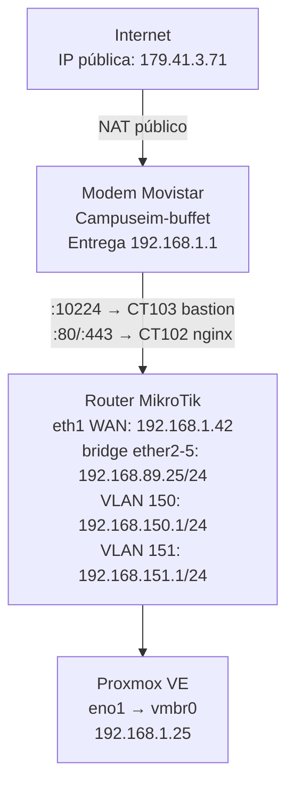

# Topología de Red

Describe la arquitectura de red completa del Bunker 4 / Campuseim: desde el acceso público hasta cada VLAN interna.

---

## Diagrama general

---

## VLANs del Proxmox

### VLAN 150 — Red Laboratorio (DMZ)
Zona de borde expuesta a internet. Solo accesible desde adentro o via SSH tuneleado.

| CT  | Nombre              | OS         | IP           | Función                                              |
|-----|---------------------|------------|--------------|------------------------------------------------------|
| 102 | nginx-proxy-manager | ArchLinux  | 10.10.150.7  | Proxy reverso HTTPS para `*.perfeccion.ar`. Admin en puerto 81, solo desde adentro o VM 105 (lubuntu-tools). No expone 443 directo — lo maneja NPM con Let's Encrypt. |
| 103 | bastion-arch        | Arch Linux | 10.10.150.8  | Único punto de entrada SSH a la red interna. Puerto externo: 10224. |

> Por arquitectura no hay puerto 443 entrante al MikroTik — NPM lo maneja internamente con Let's Encrypt o Cloudflare.

---

### VLAN 151 — Red Contenedores
Servicios internos de la escuela. Permite NAT hacia afuera. No expone SSH directo — acceso solo via bastion.

| Node | Nombre         | OS           | IP              | Función                              |
|------|----------------|--------------|-----------------|--------------------------------------|
| CT 107 | testvlan2   | Ubuntu 22.04 | 10.10.151.2     | Laboratorio de contenedores          |
| VM 105 | lubuntu-tools | Ubuntu      | 10.10.151.3     | Tools, browsers, Winbox, servidores menores no clusterizados |
| VM 300 | Ainsophic   | Alma 9.5     | 10.10.151.4     | Raro: llega bien al MKT pero aparece por 192.168.89.22 |
| CT ??? | pi-hole     | —            | propuesto       | DNS blocker (pendiente de crear)     |

---

### VLAN 152 — Kubernetes
Cluster K8s auto-gestionado. VMs en proceso de migración a esta VLAN.

| Node   | Nombre    | OS           | IP              | Estado                                  |
|--------|-----------|--------------|-----------------|------------------------------------------|
| VM 200 | k8s-ctrl  | Ubuntu 24.04 | 192.168.89.196  | Control plane activo                    |
| VM 201 | k8s-node  | Ubuntu 24.04 | —               | Guest not running — migrar a VLAN 152   |

---

### VLAN 153 — Playground / Padawans
Entorno aislado para aprendizaje y pruebas de los alumnos.

| Node   | Nombre    | OS           | IP           | Estado                          |
|--------|-----------|--------------|--------------|----------------------------------|
| CT 100 | testvlan3 | —            | 10.10.153.2  | Revisar DNS con Lautaro          |
| CT 108 | kevin01   | Ubuntu 24.04 | 10.10.153.4  | Stack Docker personal de Kevin   |

---

## Red de laboratorio — 192.168.89.0/24

Máquinas físicas y VMs de la escuela, conectadas via Switch Lab (bridge al MikroTik).

| Host           | IP              | Descripción                          |
|----------------|-----------------|---------------------------------------|
| Sopalajo       | 192.168.89.1    | —                                     |
| VM SRDEP01     | 192.168.89.151  | —                                     |
| CT 106         | 192.168.89.52   | testvlan Ubuntu 22.04 (ej. Rails, Streamlit) |
| PC01, PC02, PC03 | —             | Computadoras del laboratorio (ACTUALIZAR) |
| campuseim-ipcl-2.4ghz | 192.168.89.0 | AP WiFi laboratorio              |
| VM 200 k8s-ctrl | 192.168.89.196 | K8s control plane (migrar a VLAN 152) |

> Servidores para la escuela sin marca de VLAN obtienen IPs del rango 192.168.89.x

---

## Redes adicionales

| Segmento          | Rango           | Dispositivo                                       | Estado              |
|-------------------|-----------------|---------------------------------------------------|---------------------|
| Campuseimsur      | 192.168.44.0    | CISCO Campuseimsur                                | ACTUALIZAR a 5G     |
| San Martín        | 192.168.90.0    | Mikrotik Campuseim-san-martin                     | —                   |
| San Martín ext    | 192.168.90.0    | campuseim-sanmartin-extendida (Laboratorio 5)     | —                   |
| Residencia        | 192.168.89.0    | campuseim-residencia-ext-ipcl                     | —                   |
| Economato         | 192.168.67.0    | AP Economato campuseim-cava                       | —                   |

---

## Pendientes (ítems de arquitectura)

- [ ] Reemplazar Modem Router Campuseim-buffet
- [ ] Actualizar Switch Lab a 1 Gbit
- [ ] Actualizar PC01/PC02/PC03
- [ ] Actualizar Compu Recepción
- [ ] ACTUALIZAR CISCO Campuseimsur a 5G
- [ ] Reiniciar MikroTik si cae campuseim-san-martin
- [ ] Migrar VM 201 (k8s-node) a VLAN 152
- [ ] Dibujar pasos de acceso SSH desde el bastion para VLAN 151 (NAT hacia afuera habilitado)
- [ ] Revisar DNS CT 100 con Lautaro
- [ ] Crear CT pi-hole en VLAN 151
